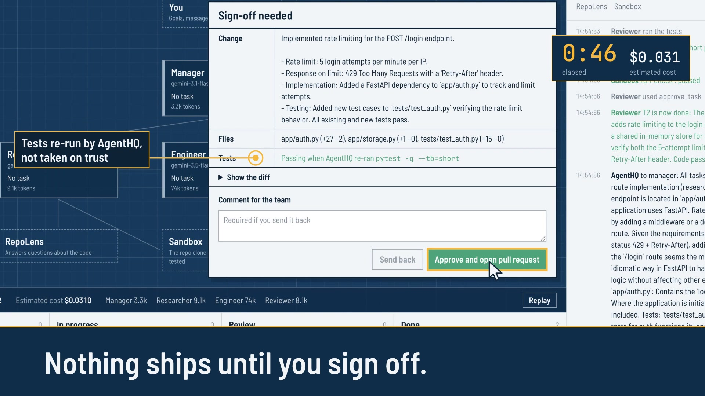
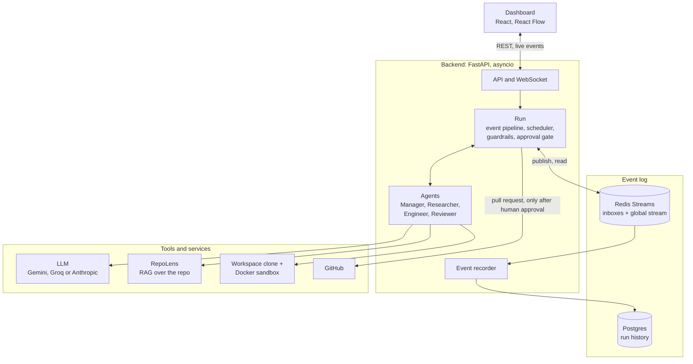

# AgentHQ

A small team of AI agents (Manager, Researcher, Engineer, Reviewer) that takes a goal for a
GitHub repository, such as "add rate limiting to /login", splits it into tasks, works on a
sandboxed clone, runs the tests, and opens a pull request only after a human signs off.
A live dashboard shows who is talking to whom, what each agent is doing, and what it costs.

The orchestration is plain Python and asyncio. No agent framework: every decision about who
does what, when, and what happens when something fails is code in this repository.

[](docs/demo.mp4)

**[Watch the 23-second demo](docs/demo.mp4)**: a real run on the sample repo, replayed in the dashboard. Goal to a reviewed,
tested change waiting for sign-off in 46 seconds, for about 3 cents.

## What it does

- **Plans and delegates.** The Manager turns the goal into 2 to 6 tasks with dependencies.
  Plain code hands each task out the moment its dependencies are done; the Manager is only woken
  when a task fails or everything is finished.
- **Uses RAG to understand the code.** The Researcher asks [RepoLens](https://github.com/ShlokGhadekar/RepoLens)
  (hybrid BM25 and vector search with checked citations), then reads the cited lines in the clone.
- **Works in a sandbox.** Each run clones the repo; tests and the linter run in a Docker container
  with no network and resource limits. Nothing touches the real repository before sign-off.
- **Reviews its own work.** Every engineering task goes to the Reviewer, who reads the diff, runs
  the tests and the linter, and approves or sends it back with comments.
- **Asks before shipping.** The pull request opens only after an approval decision from a human,
  with a diff and test results the system produced itself.
- **Stays inside limits.** Step limits per task and per run, a token cap, loop detection, retries
  with backoff, and pause, resume and stop.
- **Remembers everything.** Every event goes to one stream; the dashboard, replay and evaluation
  metrics are all built from it. Any past run can be replayed step by step.

## Architecture



**One path for every event.** Agents never change state directly. They publish events through
`Run.publish`, which applies the event to the task board, writes it to Redis (the agent's inbox and
the global stream, in one transaction), enforces the guardrails and works out what follows, all
under one lock. The task board, the dashboard and replay are all "fold the events in order".

**An agent** is an async loop: read its inbox, add the message to that task's conversation, call
the LLM with its role prompt and tools until a turn-ending tool (submit, approve, create tasks) or
a reply ends the turn, then wait for the next message. Agents message each other directly, for
example the Engineer asks the Researcher a question without going through the Manager.

| Part | Code |
|---|---|
| Event model, task board | `backend/agenthq/events.py`, `tasks.py` |
| Bus on Redis Streams | `backend/agenthq/bus.py` |
| Run: event pipeline, scheduler, approval gate | `backend/agenthq/runtime.py` |
| Agent loop, team config | `backend/agenthq/agent.py`, `agents.yaml` |
| Tools | `backend/agenthq/tools.py` |
| Guardrails | `backend/agenthq/guards.py` |
| RepoLens adapter | `backend/agenthq/repolens.py` |
| Workspace, sandbox, pull requests | `backend/agenthq/workspace.py`, `sandbox.py`, `pull_requests.py` |
| LLM clients (Gemini, Groq, Cerebras, Anthropic, scripted fake) | `backend/agenthq/llm/` |
| History in Postgres | `backend/agenthq/storage.py` |
| Evaluation harness | `backend/agenthq/evals.py`, `evals/` |
| Dashboard | `frontend/src/` |

Design decisions, with the alternatives and trade-offs, are in [DECISIONS.md](DECISIONS.md).
Likely interview questions and short answers are in [INTERVIEW_NOTES.md](INTERVIEW_NOTES.md).

## Run it

Needs Docker, and [RepoLens](https://github.com/ShlokGhadekar/RepoLens) checked out next to this
repository (or set `REPOLENS_PATH` in `.env`).

```bash
cp .env.example .env        # add GEMINI_API_KEY for the agents and GROQ_API_KEY for RepoLens
docker compose up -d --build
```

Open http://localhost:3000 and start a run. Tick "Scripted demo" to watch the team without an API
key or repository. To let approved runs open pull requests, add a `GITHUB_TOKEN` to `.env`: a
fine-grained token for the target repository with Contents and Pull requests set to read and write.

Past runs stay in the run list (they are recorded in Postgres); pick one and press Replay to step
through it event by event.

From the terminal (from `backend/`, with the compose services running):

```bash
.venv/bin/python -m agenthq.cli run "Add rate limiting to /login" --demo
.venv/bin/python -m agenthq.cli run "Add a /health endpoint" --repo https://github.com/ShlokGhadekar/agenthq-sample-notes
.venv/bin/python -m agenthq.cli tail   # every event of every run, straight from Redis
```

## Develop

```bash
cd backend
python3.12 -m venv .venv && .venv/bin/pip install -e ".[dev]"
.venv/bin/python -m pytest -q          # 150 tests, about 5 seconds, no services needed
.venv/bin/python -m pytest -m docker   # the real Docker sandbox
.venv/bin/ruff check .

cd ../frontend
npm install
npm run dev    # http://localhost:5173, forwards /api and /ws to the backend on :8080
npm test       # reducer tests
```

## Evaluation

`evals/` holds 10 tasks on the [sample repo](https://github.com/ShlokGhadekar/agenthq-sample-notes)
(4 easy, 4 medium, 2 hard), each with hidden acceptance tests and a reference solution. Every
task runs twice: by the four-agent team, and by one agent with all the same tools
(`backend/agenthq/agents_solo.yaml`), under the same runtime, guardrails and token cap. A task
passes when the repo's own test suite and the hidden acceptance tests pass in a fresh sandbox.

| Mode | Success rate | Avg tokens | Avg cost (list price) | Avg time | Avg LLM calls |
|---|---|---|---|---|---|
| Team | 10/10 | 103k | $0.033 | 1.3 min | 26 |
| Single agent | 10/10 | 126k | $0.042 | 1.8 min | 21 |

Both modes solved every task, so on this task set the team's advantage is efficiency, not success:
it used fewer tokens on 7 of the 10 tasks (18% fewer on average) and finished faster, because each
agent works in a short conversation about one task instead of one long conversation about everything.
It lost on the hardest task, `delete_account`, where the Reviewer sent the work back over a lint error
and the extra round cost 100k tokens. One run per task and mode, so the per-task numbers are noisy;
the next step is harder tasks that separate the two on success. Models: Gemini 3.5 Flash-Lite for the
Engineer and the single agent, Gemini 3.1 Flash-Lite for the other roles. Full results:
[evals/REPORT.md](evals/REPORT.md); every run can be replayed in the dashboard.

```bash
.venv/bin/python -m agenthq.evals run       # all tasks, both modes; skips pairs already scored
.venv/bin/python -m agenthq.evals report    # rewrite evals/REPORT.md from evals/results.json
.venv/bin/python -m pytest -m evals         # every acceptance test fails before, passes after its reference solution
```

## Status

| Part | State |
|---|---|
| Runtime, bus, tools, guardrails, approval gate, dashboard, replay | Done and tested |
| Live end-to-end run on the sample repo with a real LLM | Done: "add rate limiting to /login" went through planning, RAG research, edits, review and sandboxed tests (14 passing) to the approval gate in a few minutes |
| Evaluation | Done: 10 tasks, team and single agent, all passing; see above |
